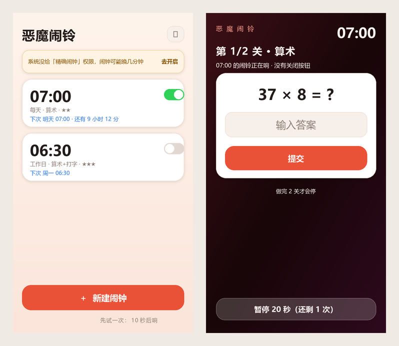

# 恶魔闹铃 · Demon Alarm

一个**关不掉**的起床闹钟：响铃时没有「关闭闹铃」按钮，状态栏挂着一条划不掉的常驻通知，
离开响铃页 1.5 秒内自动弹回，进程被杀 → 精确看门狗闹钟把它叫回来。
唯一的出口是**做完起床关卡**（算术 / 摇晃 / 记忆 / 打字 / 大喊）。完全离线，不联网、不要账号。

<p align="center">
  
</p>

<p align="center">
  <a href="https://github.com/LFLmLXY/demon-alarm/releases/latest"></a>
  
  
  
  
  
</p>

## 界面预览



> 左：主界面（奶油底 + 珊瑚红 + 白色卡片）｜右：响铃页（深红渐变 + 白色答题卡）。
> 这两张是按真实色值渲染的示意图（不是真机截图），生成脚本在 `tools/` 里。


- 安装包：[`demon-alarm.apk`](https://github.com/LFLmLXY/demon-alarm/releases/latest)（60.8 KB，也可以自己 `node build.mjs` 现编）
- 包名：`com.demon.alarm` ｜ 版本 **1.6**（versionCode 7） ｜ **Android 8.0+（minSdk 26）**，targetSdk 34
- 签名：v2 + v3，自签名（自用）；keystore 固定在 `signing/demon.keystore`，1.2 起可**覆盖安装**

### 1.6 改了什么

实测反馈：「仅震动模式按了暂停按钮后，关屏就不亮屏、也不震了」。两个独立的原因：

- **暂停的那一下走错调度通道**：普通闹钟用 `setAlarmClock`（Doze 不会推迟），而「暂停」用的是
  `setExactAndAllowWhileIdle` —— 熄屏进入 Doze 后它会被推迟到维护窗口，同一个 app 还有「9 分钟一次」的配额，
  所以暂停 10 秒实际可能几分钟后才响，甚至整轮丢掉。现在暂停也走 `setAlarmClock`，并额外配一个 15 秒后的安全副本。
- **「已结束」标记没有被重置**：点过暂停会置上 `RingActivity.dismissed`，而服务看到这个标记就再也不拉起响铃页
  （它以为这一轮已经处理过了），要等下一次 `onCreate` 才清 —— 可响铃页永远等不到。现在每轮响铃开始时（`begin()`）
  先 `resetDismissed()`。
- **补一把亮屏锁**：锁屏下 `startActivity` 可能被系统拦，全屏 intent 也不保证立刻兑现，「仅震动」又没有声音提醒。
  现在响铃服务会拿 `SCREEN_BRIGHT_WAKE_LOCK | ACQUIRE_CAUSES_WAKEUP` 把屏幕点亮 12 秒（响铃期间按需再点）。
- 版本 1.6（versionCode 7），签名不变，可直接覆盖安装。

### 1.5 改了什么

- **换了一套亮色主题**：原来的近黑界面被吐槽「黑不溜秋不想点进去」。现在主界面 / 编辑页 / 设置页统一成
  奶油纸面 `#FDF6F1` + 珊瑚红 `#EA5237` + 白色圆角卡片（带 2dp 投影）+ 顶部到底部的暖色渐变，
  状态栏、导航栏也改成浅色。文字主色 `#221B1A`，次要文字 `#8C7C74`，保证浅底上的对比度。
- **响铃页保留深红**：它是凌晨四点叫醒你的那一页，用深红渐变 `#3D1017 → #180608 → #2E0A1E` + 珊瑚高光 `#FF9E8A`；
  关卡答题区专门垫了一张白色卡片 —— 之前关卡里是深色文字，直接放在深色背景上看不清。
- **新图标**：珊瑚 → 琥珀渐变底（`ic_launcher_bg`）+ 白色闹钟（两个铃铛、两条小腿、红指针，`ic_launcher_fg`），
  做成自适应图标（anydpi-v26），圆角/圆形遮罩下都不会被裁。
- 版本 1.5（versionCode 6），签名与 1.2–1.4 完全相同，可直接**覆盖安装**，不用卸载。

预览图（按真实色值渲染的示意图，不是真机截图）：`docs/screens-preview.png`（主界面 + 响铃页）、
`docs/icon-preview.png`（新图标在方形/圆形遮罩下的样子）。

### 1.4 改了什么

- **震动强度可调**：设置页新增「震动强度」三档 —— **标准 60% / 强 85%（默认）/ 最强 100%**。
  之前 1.3 把波形幅度写死成 255（满幅），连续震久了马达会发热、耗电，也更容易被 ROM 掐；
  85% 和 100% 的听感几乎没差别，但对马达更友好，所以默认改成 85%。
- 关于「会不会伤手机」：255 是 Android API 允许的上限，并不超出马达规格，和来电/闹钟震动是同一档；
  真正的代价是**长时间连续满幅**——耗电、马达发热、长期机械磨损、放硬桌面时容易共振「跳桌子」。
  闹钟从响到过关通常几十秒到两分钟，属于正常范围；如果你习惯让它响很久，选「标准」或「强」。

### 1.3 改了什么

- **「仅震动」模式改成真·连续震动**：原来的震动波形是 900ms 震 / 350ms 停的循环，而且只在每 30 秒「重挂」一次，
  万一被 ROM 掐掉，就会出现「震 2 秒 → 静 28 秒」的情况，正好睡得更香。
  现在：
  - 仅震动用 **900ms 震 / 90ms 停** 的紧凑波形，听感上就是一直在震（铃声+震动仍是跟着铃声节奏的 800/300）；
  - 波形幅度按设置取 **标准 153 / 强 217 / 最强 255**（1.4 起可调，默认 217），不再固定满幅；
  - **每 2.5 秒自动重挂一次**（带铃声时每 20 秒），被系统/ROM 掐掉后最多 2.5 秒就接回来；
  - 震动通道仍是 `USAGE_ALARM`，锁屏、静音、勿扰都照震。
- **顺便**：日志里能看到震动失败的具体原因（首页「上次错误」），不再是静默失败。

> 1.2 → 1.3 **同签名，直接覆盖安装即可**，闹钟和设置全部保留。

### 1.2 改了什么

- **锁屏后震动不震 → 修好了**：震动改用 **`USAGE_ALARM`** 通道（`VibrationAttributes`，旧系统走 `AudioAttributes`），
  静音 / 勿扰 / 锁屏时都不再被系统静默丢掉；Android 12+ 用 `VibratorManager` 取马达。
  排查时顺便提醒：如果某个闹钟的「响铃方式」被选成了**仅铃声**，那本来就不会震。
- **一次响铃可以连闯 1–5 关**：新建/编辑闹钟里新增「一次响铃要连过几关」（默认 **2 关**），
  第 1 关过完立刻接第 2 关，全部过完闹铃才停；每 2 关难度自动 +1（最多 +2），且相邻两关不会是同一种关卡。
  响铃页顶部显示「第 2 / 3 关 · 摇晃手机」，不会再出现「过完一关倒回去继续睡」。
- **签名固定下来了**：keystore 从 `build/` 挪到 `signing/demon.keystore`，以后版本之间可以**覆盖安装**。
  （1.1 的签名随构建目录被清掉了，所以 **1.1 → 1.2 要先卸载旧版**，旧闹钟需要重设一次；往后再升级就不用卸了。）

### 1.1 改了什么

- **闹钟不再靠「进程活着」才响**：排程改用 `setAlarmClock`（系统闹钟级别，Doze 不延迟，状态栏和锁屏上能看到闹钟图标），
  并在 20 秒后埋一颗**备用闹钟**；主闹钟的广播万一被 ROM 吞掉，备用闹钟照样把它叫醒。
- **加了一个「守护」前台服务**：只要还有启用的闹钟，状态栏常驻「恶魔闹铃 · 守护中 · 下一个闹钟 今天 07:00 · 还有 8 小时」，
  每 3 分钟自检一次并重新排程 —— 被清理后台干掉也能自己长回来，还能一眼确认「闹钟真的排上了」。
- **修「设 1 分钟后响，结果不响 / 推到明天」**：现在选中的分钟只要刚过去 3 分钟以内，就当成「马上响」处理（3 秒后），
  不再傻乎乎跳到明天；保存时会提示「闹钟已排：今天 14:31 · 还有 3 秒」。
- **新建闹钟默认时间改成「下一分钟」**，不再默认早上 07:00。
- **新增响铃方式**：`铃声 + 震动`（默认）/ `仅铃声` / `仅震动`。
- 服务启动被系统拒绝时不再静默失败：自动降级成带声音+全屏意图的高优先级通知，兜底仍然会响。

---

## 一、装到手机上（3 步）

1. 把 `demon-alarm.apk` 传到手机（微信文件传输 / QQ / 数据线 / 网盘都行）。
2. 点开 APK → 系统问「是否允许安装未知应用」→ **允许** → 安装。
   （部分手机提示「扫描有风险 / 未经应用商店审核」，选**继续安装**即可，这是自签名 APK 的正常提示。）
3. 打开「恶魔闹铃」。

## 二、第一次打开：必须放行的 3 件事

首页顶部会出现一条引导横幅，**逐条点掉**（这是「闹钟能真的响、且关不掉」的前提）：

| 授权 | 为什么必须给 | 不给的后果 |
| --- | --- | --- |
| **通知**（Android 13+） | 状态栏常驻通知就是「关不掉」的核心 | 看不到常驻通知，体验不完整 |
| **闹钟与提醒**（精确闹钟，Android 12+） | 用 `setAlarmClock/精确闹钟` 准点唤醒 | 可能晚几分钟甚至更久才响 |
| **电池优化 → 关闭（无限制）** | 省电策略会冻结甚至杀掉响铃进程 | 半夜掉进「深度睡眠」被静默 |

额外建议（尤其国产 ROM）：设置里给「恶魔闹铃」打开 **自启动 / 后台运行 / 锁屏显示 / 允许全屏通知**。
横幅显示「已就绪」后就可以正常用了。

## 三、怎么用

- **新建闹钟**：首页底部「＋ 新建闹钟」
  - 拖轮选时/分；点星期（有 `每天 / 工作日 / 周末 / 仅一次` 四个快捷键；`仅一次` = 只响一次，响完自动关）
  - 选关卡：**摇晃 / 算术 / 记忆 / 打字 / 大喊**，可多选，至少一个
  - 难度 ★1–5：越大数范围越大、摇晃次数越多、记忆位数越多、要打的句子越长
  - **一次响铃要连过几关** 1–5（默认 2）：第 1 关过完立刻接第 2 关，全部过完闹铃才停；
    每 2 关难度自动 +1（最多 +2），相邻两关不会是同一种关卡。只设 1 关，人很容易过完倒回去接着睡。
  - **响铃方式**：`铃声 + 震动` / `仅铃声` / `仅震动`（上课、开会、不想吵到别人时选仅震动）
  - 暂停次数 0–6：这一夜你最多能买几次「暂停」；0 = 一次都不给
  - 备注：显示在响铃页和列表上
  - 保存后会提示「闹钟已排：今天/明天 HH:mm · 还有 X」，列表里的闹钟也会显示下一次响的时间
- **开关 / 删除**：列表右侧开关临时停用；长按卡片删除
- **试一次（强烈建议）**：首页最下面「先试一次：10 秒后响」——10 秒后整条链路走一遍，
  用来确认通知、全屏弹出、关卡、暂停都正常。试完记得删掉那条「试响」。

## 四、它为什么关不掉（7 重机制）

1. **状态栏常驻通知**：`setOngoing(true)` 且**没有任何关闭 action**，无法左右划掉；点它只会打开响铃页。
2. **响铃页跑不掉**：返回键、音量键、菜单键全部吞掉；Home 键回桌面 → 1.5 秒内自动弹回；
   锁屏状态下也会亮屏弹出（`showWhenLocked` + `turnScreenOn`）。
3. **大退也活着**：任务从最近任务划掉 → `onTaskRemoved` 立刻复活；服务 `START_STICKY`。
4. **进程被杀也活着**：进程死的瞬间起一个 60 秒的精确看门狗闹钟，广播把服务重新拉起（响铃状态存在 SharedPreferences）。
5. **重启/改时间也活着**：开机、时间变更、时区变更、app 更新都会重新排程 + 恢复正在响的那一次。
6. **闹钟本身不会丢**：用 `setAlarmClock` 排程（系统闹钟级，状态栏显示闹钟图标），并且 20 秒后再埋一颗备用闹钟，
   主广播被吞掉也能补响；守护服务每 3 分钟自检重排一次。
7. **服务起不来也响**：系统拒绝启动前台服务时，降级为高优先级+全屏意图的通知，15 秒后看门狗再试一次。

**唯一的出口**：做完关卡（或花掉一次「暂停」）。暂停不是关闭 ——
第 1/2/3/4 次分别只买 **10 / 20 / 40 / 60 秒**，到点**同一个闹钟自己再响**，而且**更难**（难度 +1，最多 +2；
并且每次都会按你设的「连过 N 关」连闯，暂停机会用完时按钮直接消失，只剩过关一条路）。

## 五、声音 / 震动

每个闹钟可以单独选**响铃方式**：

| 方式 | 铃声 | 震动 | 适合 |
| --- | --- | --- | --- |
| 铃声 + 震动（默认） | 系统默认闹钟铃声循环 | 按波形循环 | 一个人住 / 睡死型 |
| 仅铃声 | 同上 | 不震 | 不想震动吵到床 |
| 仅震动 | 完全不响铃 | 按波形循环 | 宿舍、合租、不想吵到别人 |

响铃（铃声或震动）会一直持续到你做完关卡，中途不衰减。
铃声走系统默认**闹钟铃声**（`USAGE_ALARM`，绕开媒体音量）；`铃声 + 震动` 与 `仅铃声` 会在响铃瞬间把闹钟音量**拉满**，
手机是静音/震动模式也会被**改回响铃模式** —— 叫醒你比礼貌重要。（设置里可以打开「允许用音量键静音」，默认关闭。）

震动同样走 **`USAGE_ALARM`** 通道（不是普通触感反馈），所以**锁屏、静音、勿扰**下都会继续震；
服务每 2.5 秒会重挂一次震动（仅震动模式），防止被 ROM 掐掉。如果某个闹钟仍然不震，依次检查：
① 该闹钟的「响铃方式」是不是选成了「仅铃声」；② 系统设置里振动强度是不是被调成了 0；
③ 勿扰模式是否允许「闹钟」打扰（`设置 → 声音 → 勿扰 → 允许闹钟`）。

## 六、已知限制（实话）

- 系统设置 → 应用 → 恶魔闹铃 → **强行停止**，能把它彻底停掉（这是安卓的最高权限，任何 app 都挡不住）。
  重新打开 app 即可恢复。
- 少数国产 ROM 的「清理后台」会无视前台服务；请在系统里给本应用开自启动/加白名单。
  只要守护通知还在（状态栏「守护中」），闹钟就还在；如果连守护通知都没了，说明系统把 app 冻结了。
- **关机不响**（没做 RTC 唤醒闹钟）；飞行模式不影响响铃，但静音开关默认会被扳回来。
- 「大喊」关卡需要麦克风权限（选中该关卡保存时会弹一次请求）；拒绝就给算术题代替。
- 只装了 `RECORD_AUDIO` 一个敏感权限，且只在「大喊」关卡里用；无网络权限，app 里没有任何联网代码。
- 设「当前这一分钟」的闹钟时，会在 3 秒内响（这是刻意的，用来避免被推到明天）。
- **1.1 → 1.2 需要先卸载旧版再装**（1.1 的签名没保住），旧闹钟要重设一次；1.2 起 keystore 固定，之后可以直接覆盖安装。

## 七、重新构建

```bash
git clone https://github.com/LFLmLXY/demon-alarm.git
cd demon-alarm
node build.mjs        # 产物 demon-alarm.apk
```

只依赖三样东西，**不需要 Gradle，也不需要联网**：

| 依赖 | 版本 | 说明 |
|---|---|---|
| Node.js | 18+ | 跑 `build.mjs` |
| JDK | 17+ | 提供 `javac` / `keytool` / `java` |
| Android SDK | build-tools **34.0.0** + platform **android-34** | 提供 `aapt2` / `zipalign` / `lib/d8.jar` / `lib/apksigner.jar` / `android.jar` |
| Python | 3.8+ | 只在最后一步把 `classes.dex` 打进 APK 时用（`tools/pack.py`） |

路径靠环境变量覆盖，都有默认值（写死的是我这台机器上的位置）：

```bash
export ANDROID_SDK_ROOT=/path/to/android-sdk   # 里面要有 build-tools/34.0.0 和 platforms/android-34
export JAVA_HOME=/path/to/jdk
export PYTHON=python3                          # 默认就是 python
export DEMON_KS_PASS=your-keystore-password    # 默认 demon123，只在本地生成 keystore 时用
```

构建链：`aapt2 compile → aapt2 link → javac → d8 → pack(python) → zipalign → apksigner`。几个必须记住的坑：

1. `javac` 必须带 **`-parameters`**：JDK 23 默认给桥接方法写 `MethodParameters` 且名字索引为 0，
   build-tools 34 里的 R8 8.2 会直接 NPE（`Cannot invoke "String.length()" because "<parameter1>" is null`）。
2. `javac` 用 **`-source 8 -target 8`** 出 Java 8 字节码，d8 才不会抱怨。
3. `resources.arsc` **不能压缩**：`tools/pack.py` 用 `ZIP_STORED` 单独把它塞回去（`zipalign -c` 会检查这一点）。
4. 签名 keystore 在 `signing/demon.keystore`（别名 `demon`）——**这个目录已被 `.gitignore` 排除**。
   第一次运行 `build.mjs` 会自动生成一把新的；**换了签名就必须先卸载旧版再装**。
   发布版（Releases 里的 APK）用的是我这台机器上的那把，所以从 Releases 下载的能直接覆盖升级。

## 八、文件结构

```
demon-alarm/
├─ demon-alarm.apk            ← 安装包（签名好的成品；发布版在 Releases 里）
├─ build.mjs                  ← 一条命令跑完的构建脚本
├─ tools/
│  ├─ pack.py                 ← 把 classes.dex 塞进 aapt2 产出的 apk（保留 resources.arsc 不压缩）
│  ├─ preview_icon.py         ← 用 Pillow 按真实几何/色值画出图标示意图
│  └─ preview_screens.py      ← 画出主界面 + 响铃页示意图
├─ docs/
│  ├─ icon-preview.png        ← 图标预览
│  ├─ screens-preview.png     ← 界面预览
│  └─ DEVLOG.md              ← 制作过程存档（每一版踩了什么坑、怎么修的）
├─ app/
│  ├─ AndroidManifest.xml
│  ├─ res/values/{strings,colors,styles}.xml
│  ├─ res/drawable/ic_launcher_bg.xml     ← 珊瑚→琥珀渐变底
│  ├─ res/drawable/ic_launcher_fg.xml     ← 白色闹钟前景
│  ├─ res/mipmap-anydpi-v26/ic_launcher.xml ← 自适应图标
│  └─ src/com/demon/alarm/
│     ├─ MainActivity/EditActivity/SettingsActivity/RingActivity.java
│     ├─ RingService.java        ← 前台服务：通知、响铃、震动、拉回前台、看门狗
│     ├─ GuardService.java       ← 守护服务：常驻通知 + 每 3 分钟自检重排闹钟
│     ├─ AlarmReceiver.java      ← 响铃/备用闹钟/看门狗/开机重新排程
│     ├─ AlarmStore.java         ← 存取 + setAlarmClock 调度 + 备用闹钟 + 响铃状态
│     ├─ Alarm.java / Settings.java / UI.java
│     └─ Challenge*.java         ← 5 种关卡；Challenges.sequence() 一次生成「连闯 N 关」的队列
├─ signing/                   ← 本机签名目录（已 .gitignore，不入库）
└─ README.md                  ← 本文件
```

## 九、为什么不用 Gradle

一开始就是奔着「拷到任何一台有 JDK 的机器上都能构建」去的：

- 没有 Gradle Wrapper、没有 AGP、没有 Maven 依赖树 —— 全部依赖只有两样：**JDK** 和 **Android SDK 里的 build-tools + platform.jar**；
- 没有 androidx —— 所有 UI 都是 `new LinearLayout()` 手写出来的，所以 APK 只有 60 KB；
- 构建脚本是 174 行 Node（`build.mjs`），七个步骤每一步打印完整命令，出问题能直接定位到是哪一步哪一条命令。

代价是放弃了 Gradle 的增量构建和 IDE 集成，以及没有 `R.java`（资源全部按名字查），但换来的是「看得懂、改得动、不玄学」。

## 十、许可

MIT（见 [LICENSE](LICENSE)）。自用项目，随便改、随便拿去给自己做一个更狠的闹钟。
不保证任何人的手机都能关得住这个闹钟 —— 但它确实尽力了。
